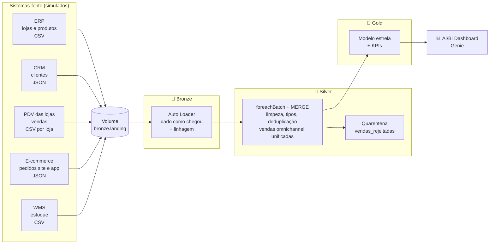
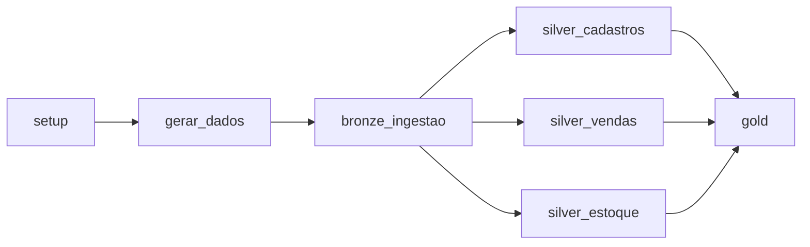

# 🧵 Trama Store · Plataforma de Dados Omnichannel no Databricks

[](https://github.com/Camilalarissa/trama-store-data-platform/actions/workflows/ci.yml)

Plataforma de dados ponta a ponta para a **Trama Store**, uma rede **fictícia** de moda com
**30 lojas físicas, site, app e cartão próprio**, inspirada no modelo dos grandes varejistas
de moda brasileiros. O projeto recebe arquivos de cinco sistemas diferentes, trata a
"sujeira" que vem de cada um e entrega um modelo analítico que responde perguntas como:

- Quanto vendemos por canal, região e loja, e com que ticket médio?
- O cliente que compra **na loja e no digital** gasta mais do que os outros?
- Quanto do e-commerce passa pelas lojas (retirada na loja)?
- Onde falta produto que está vendendo?
- Quantos dados chegam com problema, e de qual sistema?

> Todos os dados são **sintéticos**, gerados por código. Nomes, CPFs e e-mails são inventados.

---

## 🏗️ Arquitetura



Tudo roda em um **Lakeflow Job** diário, definido como código num **Bundle**:



## 🧰 O que o projeto demonstra

| Tema | Como aparece no projeto |
| :--- | :--- |
| **Ingestão incremental** | Auto Loader (`cloudFiles`) com `availableNow`, evolução de schema e linhagem por arquivo |
| **Carga idempotente** | Structured Streaming + `foreachBatch` + `MERGE` pela chave de negócio |
| **Dados reais são sujos** | Vírgula decimal, datas `dd/MM/yyyy`, duplicatas, JSON aninhado, eventos fora de ordem, cancelamentos tardios, UTC × horário de Brasília |
| **Qualidade de dados** | Regras declaradas em código e quarentena com motivo da rejeição |
| **Modelagem** | Vendas de loja e digital no mesmo esquema; modelo estrela na Gold |
| **Governança e LGPD** | Unity Catalog (catálogo por ambiente, schemas por camada, Volumes); CPF só como hash; Gold sem dados pessoais |
| **Performance** | Liquid Clustering definido na criação das tabelas, predictive optimization, tabelas de KPI pré-agregadas |
| **Engenharia de software** | Lógica em funções puras testadas com pytest e Spark local (inclusive o SQL da Gold) |
| **CI/CD** | Bundle com targets `dev`/`prod`, GitHub Actions para testes e deploy |

As escolhas e seus motivos estão em **[docs/decisoes.md](docs/decisoes.md)**.

## 📊 Exemplo de resultado

Com dois dias de dados gerados (execução dos testes):

| Perfil de cliente | Clientes | Compras por cliente | Gasto médio |
| :--- | ---: | ---: | ---: |
| Omnichannel | 495 | 2,77 | R$ 723,06 |
| Só loja física | 1.208 | 1,30 | R$ 366,32 |
| Só digital | 662 | 1,17 | R$ 272,67 |

| Canal | Vendas | Faturamento líquido | Ticket médio |
| :--- | ---: | ---: | ---: |
| Loja física | 5.066 | R$ 1.430.693,56 | R$ 282,41 |
| App | 848 | R$ 192.369,12 | R$ 226,85 |
| Site | 557 | R$ 133.095,16 | R$ 238,95 |

## 📁 Estrutura

```
trama-store-data-platform/
├── databricks.yml                 # Bundle: projeto como código (targets dev e prod)
├── resources/
│   └── pipeline_diario.job.yml    # Job diário com 7 tasks
├── src/
│   ├── trama/                     # Lógica reutilizável e testável
│   │   ├── gerador.py             # Gerador de dados sintéticos
│   │   ├── fontes.py              # Formato e opções de cada fonte
│   │   ├── transformacoes.py      # Bronze → Silver (funções puras)
│   │   └── incremental.py         # foreachBatch + MERGE
│   ├── notebooks/                 # Orquestração no Databricks (00 a 06)
│   └── dashboards/                # Consultas do dashboard
├── tests/                         # pytest com Spark local
├── docs/                          # Decisões, modelo de dados e roadmap
└── .github/workflows/             # CI (testes) e deploy
```

## 🚀 Como executar

### Pré-requisito

Uma conta no **[Databricks Free Edition](https://www.databricks.com/learn/free-edition)** (gratuita).

### Opção A · Pela interface (sem instalar nada)

1. No workspace, vá em **Workspace → Create → Git folder** e cole a URL deste repositório.
2. Abra `src/notebooks/00_setup.py` e rode. Ele cria o catálogo `trama_store_dev`.
   - Se aparecer erro de permissão para criar catálogo, use `workspace` no widget `catalogo`
     em todos os notebooks.
3. Abra `01_gerar_dados.py`, preencha `dias_historico = 30` e rode (gera 30 dias de histórico).
4. Rode os notebooks `02` a `06`, nessa ordem.
5. Para automatizar, crie um Job em **Jobs & Pipelines** com as tasks na ordem do diagrama.

### Opção B · Com o Bundle e a Databricks CLI (como em uma empresa)

```bash
# 1. Instale a CLI: https://docs.databricks.com/dev-tools/cli/install
databricks auth login --host https://<seu-workspace>.cloud.databricks.com

# 2. Valide e implante no ambiente de desenvolvimento
databricks bundle validate
databricks bundle deploy -t dev

# 3. Primeira execução com 30 dias de histórico
databricks bundle run -t dev pipeline_diario --params dias_historico=30
```

Depois disso, o Job roda sozinho todo dia às 6h (no target `prod`; no `dev` o agendamento fica pausado).

### Testes locais

Requer Python 3.12+ e Java 17+.

```bash
pip install -r requirements-dev.txt
pytest
```

Os testes geram dados, aplicam as transformações da Silver e executam o SQL da Gold em um
Spark local. Os comandos exclusivos do Databricks (Auto Loader, Delta e `MERGE`) só rodam no
workspace.

## 📚 Documentação

- [Decisões técnicas](docs/decisoes.md): o porquê de cada escolha
- [Modelo de dados](docs/modelo_de_dados.md): fontes, tabelas e colunas
- [Roadmap](docs/roadmap.md): próximas fases (devoluções, logística, marketing, cartão, RH e IA)

## 👩‍💻 Autora

**Camila Larissa Gonçalves** · Engenheira de Dados
Databricks Fundamentals Accreditation (2026)
