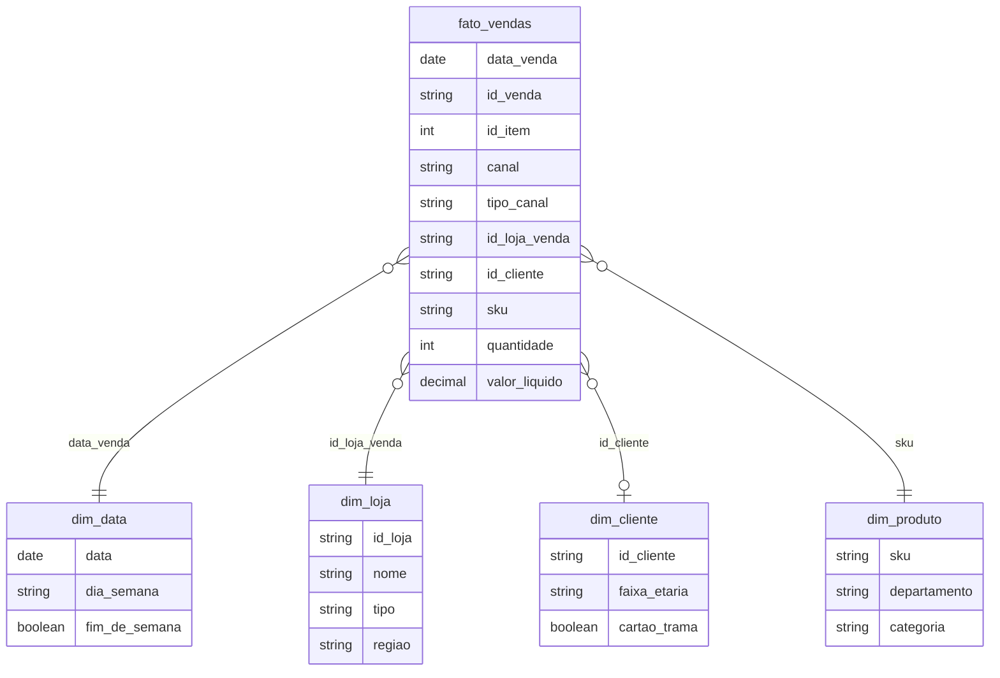

# Modelo de dados

## Fontes (landing)

| Sistema | Pasta | Formato | Frequência | Particularidades |
| :--- | :--- | :--- | :--- | :--- |
| ERP | `erp_lojas/` | CSV `;` | Carga inicial | 30 lojas + 2 centros de distribuição |
| ERP | `erp_produtos/` | CSV `;` | Diária (alterações) | Preço com vírgula decimal |
| CRM | `crm_clientes/` | JSON Lines | Diária (novos e alterados) | Endereço, fidelidade e consentimento aninhados; CPF com e sem máscara; e-mail despadronizado |
| PDV | `pdv_vendas/<data>/` | CSV `;` por loja | Diária | Vírgula decimal, data `dd/MM/yyyy`, linhas reenviadas, SKU vazio, quantidade inválida |
| E-commerce | `ecommerce_pedidos/` | JSON Lines | Diária | Itens em array, horário UTC, eventos duplicados e cancelamentos posteriores fora de ordem |
| WMS | `estoque/` | CSV `;` | Diária | Foto do fim do dia por local e SKU |

## Bronze

Uma tabela por fonte, com o mesmo nome da pasta (`bronze.pdv_vendas`, ...). Todas as
colunas como texto, mais:

| Coluna | Descrição |
| :--- | :--- |
| `_arquivo_origem` | Caminho do arquivo que originou a linha |
| `_ingerido_em` | Data/hora da ingestão |
| `_rescued_data` | Campos que não couberam no schema (criada pelo Auto Loader) |

## Silver

| Tabela | Chave | Atualização |
| :--- | :--- | :--- |
| `lojas` | `id_loja` | MERGE |
| `produtos` | `sku` | MERGE pela versão mais recente (`atualizado_em`) |
| `clientes` | `id_cliente` | MERGE pela versão mais recente |
| `vendas_itens` | `id_venda + id_item` | MERGE pela versão mais recente |
| `vendas_rejeitadas` | `id_venda + id_item` | Só inserção (quarentena) |
| `estoque` | `data_estoque + id_local + sku` | MERGE |

### `silver.vendas_itens`

| Coluna | Tipo | Descrição |
| :--- | :--- | :--- |
| `id_venda` | string | Cupom do PDV ou número do pedido |
| `id_item` | int | Posição do item na venda |
| `canal` | string | `loja_fisica`, `site` ou `app` |
| `id_loja_venda` | string | Loja da venda; `ECOM` para o digital |
| `id_loja_retirada` | string | Loja onde o pedido online foi retirado (se houver) |
| `modalidade_entrega` | string | `presencial`, `entrega_domicilio` ou `retira_loja` |
| `id_cliente` | string | Nulo quando o cliente não se identificou no caixa |
| `sku` | string | Produto |
| `quantidade` | int | Peças |
| `preco_unitario` | decimal(12,2) | Preço de tabela |
| `valor_bruto` | decimal(12,2) | `quantidade × preco_unitario` |
| `desconto` | decimal(12,2) | Desconto do item |
| `valor_liquido` | decimal(12,2) | `valor_bruto − desconto` |
| `forma_pagamento` | string | Cartão Trama, Crédito, Débito, Pix, Dinheiro, Boleto |
| `status` | string | `concluida` (PDV), `aprovado`, `cancelado`, `pagamento_pendente` |
| `data_hora_venda` | timestamp_ntz | Horário de Brasília |
| `data_venda` | date | Data da venda |
| `atualizado_em` | timestamp_ntz | Versão da linha (usada no MERGE) |
| `arquivo_origem` | string | Linhagem até o arquivo |

## Gold (modelo estrela)

| Tabela de KPI | Grão | Principais métricas |
| :--- | :--- | :--- |
| `kpi_vendas_diarias` | dia × canal × loja | vendas, peças, faturamento bruto/líquido, descontos, ticket médio |
| `kpi_mix_departamento` | dia × tipo de canal × departamento | faturamento e participação |
| `kpi_clientes_perfil` | perfil (omnichannel, só loja, só digital) | clientes, compras por cliente, gasto médio |
| `kpi_ruptura_estoque` | local × SKU zerado | peças vendidas nos 7 dias anteriores |
| `kpi_qualidade_dados` | dia × canal × motivo | linhas rejeitadas |
